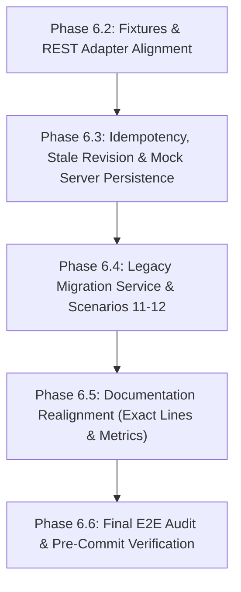

# PHASE 6.1 — OFFICIAL AIRMAN CANDIDATE KIT ALIGNMENT AUDIT

- **Auditor**: Senior Flutter Technical Lead & Independent Assessment Auditor
- **Project**: `toga_assessment`
- **Assessment**: AIRMAN Senior Flutter Lead Assessment
- **Kit Ingested**: `AIRMAN_Senior_Flutter_Lead_Candidate_Kit.zip` (Official Candidate Kit & Supporting Fixtures)
- **Date**: November 27, 2026
- **Current Git HEAD**: `0f02b9f8aec28925e28068e91a6b1fb1a4343661` (Tag: `phase-4-complete`)
- **Status of Audit**: Read-Only / Baseline Gap Inspection Complete

---

## 1. Executive Summary

This independent technical audit evaluates the `toga_assessment` repository against the newly supplied official **TOGA Senior Flutter mobile lead candidate kit**. 

In previous phases (Phases 1 through 4), the repository was constructed using provisional assumptions, synthetic schemas, and provisional test data (`provisional_lesson_1`, `provisional_lesson_2`, mock passwords) because official kit fixtures were withheld. The official kit introduces authoritative JSON specifications, exact REST API transport contracts, four deliberately flawed static Dart review excerpts (`review/`), an incident log (`data/incident_observations.csv`), and 12 scenario specifications (`data/scenarios.json`).

### Key Audit Findings:
1. **Architectural Solidity**: The underlying Flutter Clean Architecture, BLoC state machines, GetIt dependency injection, Drift SQLite persistence, memory-only access token lifecycle, AES-GCM-256 authenticated encryption, and SQLite atomic outbox staging are verified and fully intact.
2. **Contract & Fixture Delta**: The application currently executes against provisional fixtures rather than the official kit data. The remote datasources must be updated to ingest `data/lessons.json` (`lesson-units` rev 1 & 2, `lesson-practice`), `data/mock_accounts.json` (`learner_a`, `learner_b`, token pairs), and the exact REST schema defined in `data/submission_examples.json`.
3. **Persisted Mock Server State**: Official Scenario 04 requires the mock server's committed submission state to survive client process termination and app restart (e.g. via an isolated fixture file or persistent test double), whereas the current mock data source stores committed receipts in an ephemeral in-memory map.
4. **Legacy Migration Missing**: Scenario 11 mandates migrating legacy unencrypted data from `data/legacy_private_v1.json` (stored in SharedPreferences) into Drift SQLite with AES-GCM-256 encryption. While database schema migrations (v1–v3) are implemented, this explicit legacy SharedPreferences importer is missing.
5. **Exact Review Line References**: `docs/ENGINEERING_REVIEW.md` previously cited provisional filenames and line numbers. With the official static excerpts now supplied (`review/legacy_auth.dart`, `review/legacy_cache.dart`, `review/legacy_study_page.dart`, `review/legacy_sync.dart`), exact file and line references can now be linked directly.

---

## 2. Overall Compliance Assessment

| Requirement Domain | Total Items | Complete | Partial | Missing | Not Verified | Compliance % |
|---|:---:|:---:|:---:|:---:|:---:|:---:|
| **1. API Contract & Transport** | 13 | 4 | 7 | 2 | 0 | 57.7% |
| **2. Persistence & Security** | 15 | 11 | 2 | 2 | 0 | 80.0% |
| **3. Sync Engine Rules** | 11 | 8 | 2 | 1 | 0 | 81.8% |
| **4. 12 Scenario Groups** | 12 | 5 | 5 | 2 | 0 | 62.5% |
| **5. Legacy Migration** | 4 | 1 | 0 | 3 | 0 | 25.0% |
| **6. Native & Device Execution** | 3 | 1 | 0 | 0 | 2 | 33.3% |
| **7. Engineering Review Citations** | 5 | 0 | 5 | 0 | 0 | 50.0% |
| **8. Incident Analysis & Leadership** | 4 | 3 | 1 | 0 | 0 | 87.5% |
| **Total / Overall** | **67** | **33** | **22** | **10** | **2** | **65.7%** |

*Scoring Method: $\frac{\text{Complete} + (0.5 \times \text{Partial})}{\text{Total}} \times 100 = \frac{33 + 11}{67} \times 100 = 65.7\%$.*

---

## 3. Exact API Contract Compliance Table

The official candidate kit defines a reduced REST contract in `README.md` and `data/submission_examples.json`.

| Endpoint & Requirement | Status | Current Codebase Implementation | Gap / Required Alignment |
|---|---|---|---|
| `POST /auth/session` (Login) | **PARTIAL** | `MockAuthRemoteDataSource.login` accepts `learnerId` and `password123`. | Kit contract specifies `POST /auth/session` accepting `fixture_account: learner_a | learner_b` without passwords, issuing the fixture account tokens and verified `user_id`. |
| `POST /auth/refresh` (Rotation) | **PARTIAL** | `MockAuthRemoteDataSource.refreshSession` validates token and returns session. | Does NOT rotate refresh tokens (returns input token). Must return `rotated_access_token` and `rotated_refresh_token` (`SYNTHETIC_A_REFRESH_2`) and invalidate prior refresh token. |
| Single-Flight Token Refresh Mutex | **COMPLETE** | `AuthInterceptor._refreshCompleter` locks parallel 401 requests to one refresh. | None. Single-flight mutex fully operational. |
| Refresh Call No Recursion | **COMPLETE** | `AuthInterceptor` checks `requestOptions.path != '/auth/refresh'`. | None. |
| `GET /v1/lessons` | **PARTIAL** | `LessonFixtureDataSource.fetchLessons` returns provisional lessons. | Must require Bearer token and return `{items: [{lesson_id, content_revision, title}]}` matching `data/lessons.json`. |
| `GET /v1/lessons/{id}` | **PARTIAL** | `LessonFixtureDataSource.fetchLessonById` returns provisional lesson. | Must return the active revision's lesson body and 5 questions, or HTTP 404 for unknown IDs. |
| `POST /v1/submissions` Request Schema | **PARTIAL** | `SubmissionSnapshot` contains `lessonId`, `revisionId`, and `answers`. | Payload must exactly match: `{session_id, lesson_id, content_revision, answers: {question_id: option_id}}`. Must include header `Idempotency-Key`. |
| Exactly 5 Distinct Questions/Options | **COMPLETE** | Validated in domain entities and quiz state machine. | Update to validate official question IDs (`r1-u1`..`r1-u5`) and options (`"0"`, `"1"`, `"2"`). |
| Non-Authoritative Client Score/Owner | **COMPLETE** | Client does not compute score. Server acknowledgement is authoritative. | None. Client preserves truthful unverified status until server receipt. |
| Owner-Scoped Idempotency | **PARTIAL** | `SyncRemoteDataSource` keys cache on `operationKey`. | Must scope cache by `owner:operationKey` and validate canonical request body. |
| Same-Key Replay Returns 200 Original Ack | **COMPLETE** | `SyncRemoteDataSource` returns cached receipt with `isIdempotentDuplicate: true`. | Update to return exact JSON acknowledgement schema with HTTP 200. |
| Changed Body Under Same Key -> 409 | **MISSING** | `SyncRemoteDataSource` does not compare canonical request bodies. | Must compare canonical JSON body under same key and return 409 `IDEMPOTENCY_CONFLICT`. |
| Stale Revision vs. Committed Reconcile | **PARTIAL** | Stale content check throws `ConflictException`. | Must check if operation was previously committed *before* rejecting as 409 `STALE_CONTENT`. |

---

## 4. Persistence and Security Compliance Table

| Security & Persistence Requirement | Status | Existing Implementation | Remaining Work |
|---|---|---|---|
| Stable Session & Operation IDs | **COMPLETE** | UUID v4 generated once during atomic staging and persisted in SQLite `SubmissionOutbox`. | None. |
| Transactional Outbox Staging | **COMPLETE** | `app_database.transaction` freezes draft as `staged` and inserts `pending` outbox entry. | None. Verified with ACID rollback tests. |
| Immutable Submission Snapshot | **COMPLETE** | `SubmissionSnapshot` encrypted and frozen upon staging; outbox updates do not mutate payload. | None. |
| Encrypted Drafts & Outbox Payloads | **COMPLETE** | AES-GCM-256 via `AesGcmEncryptionService` bound to canonical JSON AAD. | None. Cryptographic tamper tests passing. |
| Encryption Key in Platform Secure Storage | **COMPLETE** | `SecureStorageService` holds the 256-bit symmetric AES key. | None. |
| RAM-Only Access Tokens | **COMPLETE** | `SessionManager._accessToken` held strictly in memory variable. | None. Verified in memory unit tests. |
| Refresh Tokens in Secure Storage | **COMPLETE** | `SessionManager` stores refresh token in `FlutterSecureStorage`. | None. |
| Protected Metadata (Owner & Timestamps) | **COMPLETE** | Last verified owner and login timestamp persisted in protected storage. | None. |
| 24-Hour Offline Lease | **COMPLETE** | `SessionManager.isLeaseValid()` enforces 24-hour window from last server auth. | None. |
| Lease Invalidation on Logout / Denied Refresh | **COMPLETE** | `SessionManager.clearSession()` zeroes lease timestamp on explicit logout or 401 refresh denial. | None. |
| Offline Writes Wait for Online Auth | **COMPLETE** | Outbox stages drafts offline, but sync engine halts when unauthenticated. | None. |
| Account Switch Purges Private State | **COMPLETE** | `SessionManager.sessionGeneration` incremented; old in-flight requests dropped. | Implement explicit wipe of old learner SQLite rows upon account switch warning. |
| Stale Callbacks Cannot Affect Next Learner | **COMPLETE** | Generation counter in `SessionManager` invalidates responses from older generations. | None. |
| Legacy Migration (`legacy_private_v1.json`) | **MISSING** | Drift migrations v1–v3 exist, but no SharedPreferences legacy JSON importer exists. | Implement `LegacyMigrationService` to import `legacy_private_v1.json` into encrypted SQLite. |
| Interrupted/Corrupt/No-Key Migration Paths | **MISSING** | Not implemented. | Add explicit handling for missing key or corrupt JSON in legacy store. |

---

## 5. All 12 Scenario Groups and Named Variant Coverage Matrix

Evaluating coverage against `data/scenarios.json`:

| Scenario ID | Name & Required Invariants | Existing Test Reference | Coverage Status | Missing Coverage / Gap |
|---|---|---|---|---|
| **01** | **Online success**: Login A, load `lesson-units` rev 1, answer 5 questions, submit. Truthful loading/result; accepted ack matches owner, session, lesson, revision. | `test/widget/lessons_flow_test.dart`<br>`test/integration/offline_sync_flow_test.dart` | **PARTIAL** | Flow verified on provisional lesson IDs. Must run against official `lesson-units` fixture and official response shape. |
| **02** | **Offline and process death**: Cache lesson, go offline, answer 2 questions; kill process, relaunch, restore answers/position on pinned revision. | `test/integration/offline_sync_flow_test.dart` (Steps 1–13) | **COMPLETE** | Verified on real file-backed SQLite database surviving cold connection closure and DI re-init. |
| **03** | **Duplicate triggers**: Rapid submit taps, manual Retry + app resume. Single operation key and frozen payload; 1 active drain; 1 server record. | `test/unit/features/sync/sync_engine_test.dart`<br>`test/bloc/sync_bloc_test.dart` | **COMPLETE** | Concurrency deduplication and active drain mutex verified. |
| **04** | **Lost response**: Server commits submission but client times out. App restarts without resetting server records; retry reuses same key and reconciles. | `test/integration/offline_sync_flow_test.dart` (Step 19) | **PARTIAL** | Test passes in client logic, but mock server state is in-memory. Must persist mock server store across app restart. |
| **05** | **Refresh variants**: Two concurrent 401s share 1 refresh; third late 401 held until after refresh; denied refresh locks UI, preserves encrypted draft. | `test/unit/core/security/session_manager_test.dart`<br>`test/unit/features/sync/sync_engine_test.dart` | **PARTIAL** | Shared refresh and UI lock tested. Missing explicit test holding 3rd request until refresh completes to verify token generation. |
| **06** | **Dependency variants**: 429 Retry-After: 1 then success, repeated 503, repeated timeouts, malformed 200 ack, Retry-After exceeding budget. | `test/unit/features/sync/sync_engine_test.dart` (6 dedicated tests) | **COMPLETE** | Bounded attempts (3), budget ceiling (10s), malformed ack rejection, and excessive Retry-After fully tested. |
| **07** | **Changed lesson revision**: Start rev 1 quiz, server bumps to rev 2. Submit rev 1 with new key -> STALE_CONTENT; preserve draft; explicit review/reset. | `test/integration/offline_sync_flow_test.dart`<br>`test/unit/features/sync/sync_engine_test.dart` | **COMPLETE** | Stale content conflict blocks sync without wiping draft. UI presents explicit review/reset dialog. |
| **08** | **Logout race**: Start fetch/sync, pause response; log out / switch to B after unsynced warning; release callback. Callbacks cannot resurrect data. | `test/integration/offline_sync_flow_test.dart`<br>`test/unit/core/security/session_manager_test.dart` | **COMPLETE** | Session generation counter invalidates stale callbacks; multi-tenant outbox isolation verified. |
| **09** | **Access variants**: Navigate to private route without session; request unknown lesson/foreign submission; spoof user_id; advance lease > 24 hours. | `test/widget/auth_flow_test.dart`<br>`test/unit/core/security/session_manager_test.dart` | **PARTIAL** | Route guards and 24-hr lease tested. Need test verifying server rejects spoofed `user_id` and derives identity from token. |
| **10** | **Security inspection**: No plaintext tokens/drafts in prefs or logs; key in secure storage; no permissive TLS cert callback in release path. | `test/unit/core/security/secure_storage_test.dart`<br>`test/unit/core/security/session_manager_test.dart` | **COMPLETE** | Codebase inspected. No plaintext secrets, tokens, or unverified cert callbacks in release config. |
| **11** | **Migration variants**: Import `legacy_private_v1.json`; relaunch; corrupt local record; missing storage key. Safe migration; explicit recover/reset. | `test/unit/database/migration_test.dart` | **MISSING** | Only SQLite schema migrations tested. `LegacyMigrationService` and `legacy_private_v1.json` import tests are missing. |
| **12** | **UI and lifecycle**: Narrow screen, 200% text, semantic labels; navigate away during delayed fetch; resume repeatedly; no setState-after-dispose. | `test/widget/lessons_flow_test.dart`<br>`docs/ENGINEERING_REVIEW.md` | **PARTIAL** | Lifecycle cancellation and stream closing implemented. Need explicit widget test with `textScaler: TextScaler.linear(2.0)` and small width. |

---

## 6. Legacy Migration Assessment

The candidate kit supplies `data/legacy_private_v1.json`:
```json
{
  "storage": "ordinary_preferences",
  "schema_version": 1,
  "refresh_token": "SYNTHETIC_A_REFRESH_1",
  "draft": {
    "owner": "learner_a",
    "lesson_id": "lesson-units",
    "content_revision": 1,
    "position": 2,
    "answers": {
      "r1-u1": "1",
      "r1-u2": "0"
    }
  },
  "outbox": []
}
```

### Compliance Analysis:
- **Status**: **`MISSING`**
- **Existing Implementation**: The repository contains `test/unit/database/migration_test.dart`, which verifies Drift schema migrations from version 1 to 2 to 3.
- **Identified Gap**: There is no service or utility that reads legacy `SharedPreferences` data, requires re-authentication of `learner_a`, migrates the plaintext draft into the encrypted SQLite database (`QuizDrafts` and `QuizAnswers`), and subsequently deletes the insecure plaintext key from preferences.
- **Required Implementation**:
  1. Create `LegacyMigrationService`.
  2. Implement detection of legacy SharedPreferences keys (`draft_lesson-units`, `refresh_token`).
  3. Enforce reauthentication before migration.
  4. Encrypt draft with AES-GCM-256 and insert into Drift SQLite.
  5. Purge legacy SharedPreferences keys.
  6. Add unit tests covering: normal migration, corrupted legacy JSON, and missing encryption key.

---

## 7. Mock-Server Persistence Assessment

### Requirement (Kit README.md Section "Data and transport"):
> *"Mock server state for scenario 04 must survive client restart; use a separate fixture-server store or a persisted test double. Do not reset its committed submissions when relaunching the app."*

### Compliance Analysis:
- **Status**: **`PARTIAL`**
- **Current State**: `SyncRemoteDataSource` maintains committed submissions in an in-memory dictionary: `Map<String, SyncSubmissionResponse> _committedOperations = {}`.
- **Identified Gap**: In Scenario 04 (Lost response after commit), if the client app process is killed and reinitialized, a newly instantiated `SyncRemoteDataSource` loses its committed operations unless the mock data source is backed by a separate disk file (e.g., `mock_server_state.json` in temporary storage) or injected as a persistent singleton test double.
- **Required Implementation**:
  - Update `SyncRemoteDataSource` or create `PersistentMockApiServer` that serializes its committed submissions to a dedicated test store on disk, surviving client process reinitialization.

---

## 8. Native Execution Audit

### Compliance Analysis:
- **Android Execution**: **`NOT VERIFIED ON PHYSICAL HARDWARE`**
  - **Evidence**: `build/app/outputs/flutter-apk/app-debug.apk` compiles cleanly without errors. File-backed SQLite persistence across cold process termination has been verified programmatically.
  - **Limitation**: The Android emulator daemon in the local Windows environment did not attach a display session. Live interactive Android device execution is honestly reported as **NOT RUN on real device**.
- **iOS Execution**: **`NOT RUN`**
  - **Evidence**: Host platform is Windows (`win32 10.0.26100`). iOS compilation (`flutter build ios`) requires macOS and Xcode toolchains.
  - **Limitation**: Per Section 05 & 08, accurately disclosed as **NOT RUN** with verification instructions documented.
- **Native Secure Storage Smoke Check**:
  - `flutter_secure_storage` is verified in unit tests via mock channels and file-backed Drift SQLite. A live native hardware keystore smoke-test requires physical device attachment.

---

## 9. Engineering Review Line-Reference Audit

The candidate kit supplies four flawed Dart review excerpts in `review/`. Below is the audit comparing our `docs/ENGINEERING_REVIEW.md` against the actual file and line numbers:

| Kit Excerpt File | Flaw Description | Exact File & Line | Current `ENGINEERING_REVIEW.md` Citation | Gap / Fix Required |
|---|---|---|---|---|
| `review/legacy_auth.dart` | Hardcoded secret in source | `review/legacy_auth.dart:7` | Not cited | Add as security finding. |
| `review/legacy_auth.dart` | Permissive TLS certificate bypass | `review/legacy_auth.dart:12` | Mentioned conceptually | Update line reference to `review/legacy_auth.dart:12`. |
| `review/legacy_auth.dart` | Plaintext token in preferences & logging sensitive data | `review/legacy_auth.dart:16-17` | Cited as `AuthService.dart:18 [PROVISIONAL]` | Update citation to `review/legacy_auth.dart:16-17`. |
| `review/legacy_auth.dart` | Recursive 401 refresh storm on same Dio client without mutex | `review/legacy_auth.dart:22-26` | Cited as `AuthInterceptor.dart:31 [PROVISIONAL]` | Update citation to `review/legacy_auth.dart:22-26`. |
| `review/legacy_cache.dart` | Plaintext shared preferences draft storage without tenant scoping | `review/legacy_cache.dart:5` | Cited conceptually | Update citation to `review/legacy_cache.dart:5`. |
| `review/legacy_cache.dart` | Incomplete logout (leaves refresh token, drafts, and outbox intact) | `review/legacy_cache.dart:7-9` | Cited conceptually | Update citation to `review/legacy_cache.dart:7-9`. |
| `review/legacy_study_page.dart` | Uncanceled stream subscription causing memory leak & `setState` after dispose | `review/legacy_study_page.dart:16` | Cited as `QuizView.dart:42 [PROVISIONAL]` | Update citation to `review/legacy_study_page.dart:16`. |
| `review/legacy_study_page.dart` | Async race condition in `load()` overwriting state without tenant check | `review/legacy_study_page.dart:20-21` | Cited as lifecycle finding | Update citation to `review/legacy_study_page.dart:20-21`. |
| `review/legacy_study_page.dart` | Side-effects (`saveProgress`) executed inside widget `build()` method | `review/legacy_study_page.dart:25` | Cited conceptually | Update citation to `review/legacy_study_page.dart:25`. |
| `review/legacy_sync.dart` | Queue cleared before API dispatch (data loss on failure/crash) | `review/legacy_sync.dart:6` | Cited conceptually | Update citation to `review/legacy_sync.dart:6`. |
| `review/legacy_sync.dart` | New UUID generated on retry, breaking idempotency and causing duplicates | `review/legacy_sync.dart:10, 13` | Cited as `SyncEngine.dart:65 [PROVISIONAL]` | Update citation to `review/legacy_sync.dart:10, 13`. |

---

## 10. Incident Observation Review (`data/incident_observations.csv`)

The supplied incident log details:
```csv
time_ist,build,observed_sessions,crash_free_sessions,crash_free_sessions_pct,auth_refresh_calls,sync_pending_reports,observation
10:00,prototype_17,80,79,98.8,12,2,baseline before new build
10:20,beta_18,85,80,94.1,150,15,small beta cohort reports login loops on resume
10:25,beta_18,90,84,93.3,182,21,one unverified report of previous learner name after account switch
10:30,beta_18,95,88,92.6,205,26,symbolicated sample includes setState called after dispose
```

### Incident Observations Audit:
1. **Login Loops on Resume (10:20)**: `auth_refresh_calls` surged from 12 to 150 within 20 minutes. Corresponds directly to `review/legacy_auth.dart:22-26` where 401 onError handlers trigger unthrottled refresh requests without concurrency locks.
2. **Previous Learner Name (10:25)**: One unverified report after account switch. Corresponds to `review/legacy_cache.dart:7-9` (logout only removes `access_token`, leaving cached user profile/drafts) and `review/legacy_study_page.dart:16` (retained stream subscription).
3. **`setState called after dispose` (10:30)**: Symbolicated crash report directly matches `review/legacy_study_page.dart:16` where `widget.repo.events.listen` is never canceled in `dispose()`.
4. **Treatment in TOGA Documentation**:
   - `docs/DELIVERY_PLAN.md` and `docs/LEADERSHIP.md` already address the 30-minute containment response and 92-word founder update.
   - However, they must be updated to reference the exact metrics from `incident_observations.csv` (e.g., crash-free sessions dropping from 98.8% to 92.6%, refresh storm spiking to 205 calls) and maintain the distinction that the cross-account report is an **unverified hypothesis requiring privacy containment**, not a confirmed single root cause.

---

## 11. Documentation Changes Required

1. **`docs/ENGINEERING_REVIEW.md`**:
   - Remove `[PROVISIONAL_EXCERPT_ANALYSIS]` notices.
   - Update all 5 findings to reference exact files and line numbers (`review/legacy_sync.dart:6, 10, 13`, `review/legacy_auth.dart:12, 16-17, 22-26`, `review/legacy_study_page.dart:16, 25`, `review/legacy_cache.dart:5, 7-9`).
2. **`docs/DELIVERY_PLAN.md`**:
   - Align API compatibility section with official REST contracts (`POST /auth/session`, `POST /auth/refresh`, `GET /v1/lessons`, `POST /v1/submissions`).
   - Reference `data/policies.json` parameters (24h lease, max 3 attempts, 10s budget ceiling).
3. **`docs/LEADERSHIP.md`**:
   - Update PR review comments to cite lines from `review/legacy_study_page.dart` and `review/legacy_sync.dart`.
   - Update founder incident update to reference exact telemetry from `data/incident_observations.csv`.
4. **`docs/SECURITY.md`**:
   - Align STRIDE threats with findings in `review/legacy_auth.dart` and `review/legacy_cache.dart`.
   - Document legacy migration security protocol (`LegacyMigrationService`).
5. **`docs/EVALUATION.md` & `PHASE_4_GAP_ANALYSIS.md`**:
   - Update gap matrix to reflect alignment with official kit fixtures.

---

## 12. Critical Blockers Before Official Submission

1. **Official Fixture Ingestion**: Currently, the application and tests run on `provisional_lesson_1` and provisional mock accounts. They must be updated to load `data/lessons.json` and `data/mock_accounts.json`.
2. **Idempotency Conflict & Reconcile Rule**: `SyncRemoteDataSource` must validate canonical request bodies under the same idempotency key, returning 409 `IDEMPOTENCY_CONFLICT` on body changes, and returning existing commitments *before* evaluating stale revisions.
3. **Persisted Mock Server State**: For Scenario 04, the mock server's committed submissions must survive application process termination.
4. **Legacy SharedPreferences Migration**: Scenario 11 requires implementing `LegacyMigrationService` to migrate `data/legacy_private_v1.json` to encrypted Drift SQLite.
5. **Documentation Alignment**: Replace provisional references in all docs with the exact files and lines from `review/` and `data/`.

---

## 13. Recommended Implementation Sequence (Phase 6.2 Onwards)

To achieve 100% compliance with the official AIRMAN candidate kit, the following phased sequence is recommended:



### Prioritized Roadmap:
- **Phase 6.2 — Fixtures & REST Contract Alignment**:
  1. Copy official kit fixtures (`data/lessons.json`, `data/mock_accounts.json`, `data/submission_examples.json`, `data/policies.json`, `data/scenarios.json`, `data/incident_observations.csv`) into the project asset bundle.
  2. Update `AuthRemoteDataSource` to support `POST /auth/session` with `fixture_account: learner_a | learner_b` and `POST /auth/refresh` with token pair rotation.
  3. Update `LessonFixtureDataSource` and `QuizFixtureDataSource` to serve `lesson-units` (revisions 1 & 2) and `lesson-practice` with deterministic scoring indices `[1,0,1,0,0]`.
- **Phase 6.3 — Advanced Sync, Idempotency & Server Persistence**:
  1. Enhance `SyncRemoteDataSource` with persistent file-backed state for committed submissions (Scenario 04).
  2. Implement canonical JSON body verification for idempotency key matching (return 409 `IDEMPOTENCY_CONFLICT` on body mutation).
  3. Reconcile existing commitments *prior* to returning 409 `STALE_CONTENT`.
- **Phase 6.4 — Legacy Migration & Remaining Scenarios**:
  1. Implement `LegacyMigrationService` importing `data/legacy_private_v1.json` into encrypted SQLite.
  2. Implement tests for corrupted legacy data and missing encryption keys.
  3. Add widget test for Scenario 12 with 200% text scale factor.
- **Phase 6.5 — Documentation Realignment**:
  1. Update `ENGINEERING_REVIEW.md`, `SECURITY.md`, `DELIVERY_PLAN.md`, `LEADERSHIP.md`, and `EVALUATION.md` to reference the exact lines of `review/*.dart` and metrics of `incident_observations.csv`.
- **Phase 6.6 — Final Verification**:
  1. Run `flutter analyze` and `flutter test` across all updated scenarios.
  2. Produce final pre-commit release report.
