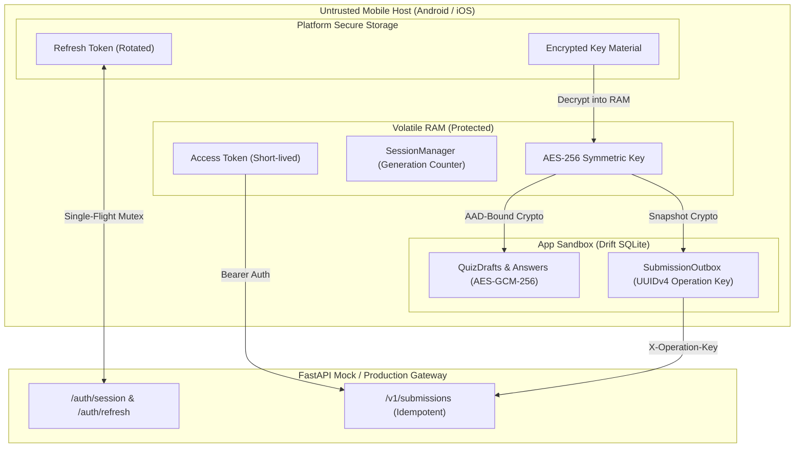

# Security Architecture & Threat Model

## 1. Security Data-Flow Architecture

---

## 2. Core Security Controls

### Authentication & Token Refresh
Access tokens exist exclusively in volatile memory (`SessionManager`), never touching persistent storage. Refresh tokens are stored securely via `flutter_secure_storage`. When expired, token rotation occurs over HTTPS using an isolated Dio client with single-flight completer mutexing to prevent concurrency storms.

### 24-Hour Offline Lease
Offline authentication is governed by a strict 24-hour lease window calculated from `lastAuthenticatedAt`. Once the lease expires, access to private learning routes is locked until online reauthentication succeeds, preventing indefinite offline access on stolen devices.

### Encrypted Private Drafts & Outbox
Private learner answers and outbox submission snapshots are encrypted at rest using AES-GCM-256. Every ciphertext block is bound to canonical JSON Additional Authenticated Data (`AAD`): `{"learnerId":...,"lessonId":...,"operationKey":...,"revisionId":...}`. Any record tampering or cross-learner swapping causes immediate MAC authentication failure (`SecurityException`) with zero plaintext fallback.

### Encryption Key Storage
Symmetric keys are generated via cryptographically secure random number generators and stored in the OS platform secure enclave (Android KeyStore / iOS Keychain).

### Learner Isolation & Account Switching
Multi-tenant isolation is enforced at the database layer: all queries, draft fetches, and outbox sweeps require matching the verified `authenticatedLearnerId`. Monotonic generational counters (`sessionGeneration`) discard any delayed asynchronous microtasks originating from previous user sessions.

### Logout & Account-Switch Cleanup
Logging out or switching accounts immediately purges in-memory access tokens, clears cached BLoC state (`ResetQuiz`), and wipes volatile encryption keys. Residual draft ciphertext remains safely encrypted on disk, accessible only when that specific learner re-authenticates.

### Legacy Migration Security
The legacy migration service imports plaintext progress from `data/legacy_private_v1.json` only after active reauthentication confirms the authenticated learner matches the legacy record owner. Legacy refresh tokens are never trusted as proof of authentication. The plaintext file is safely deleted only after transactional encrypted persistence succeeds in SQLite.

### Idempotent Submission
Every quiz attempt freezes into a durable outbox record stamped with an immutable RFC 4122 v4 UUID `operationKey`. The mock server persists operation receipts independently; retried requests return the identical acknowledgement without re-scoring or duplicate database insertions.

---

## 3. Residual Risks & Production Hardening
- **Rooted / Jailbroken Devices**: Memory inspection can compromise volatile RAM; production requires runtime root detection and memory obfuscation.
- **Biometric Binding**: Future iterations should bind key access to biometric hardware prompts (`BiometricPrompt`).
