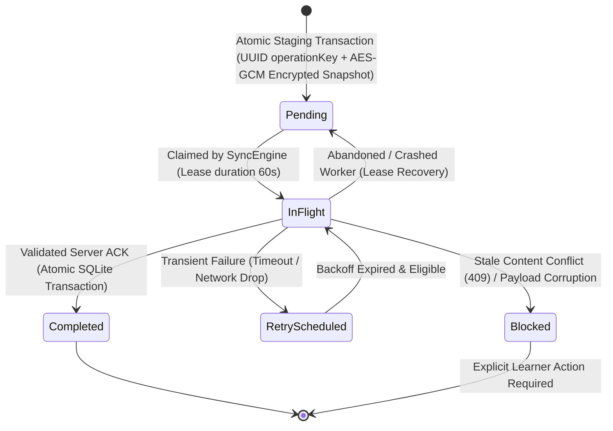

# Synchronization Architecture & Outbox Lifecycle
## AIRMAN TOGA Assessment

*Tag: PROVISIONAL_DEVELOPMENT_FIXTURE_NOT_OFFICIAL_AIRMAN_DATA*

---

### 1. The Submission Outbox Lifecycle

### 2. State Descriptions

1. **Pending**:
   - Created atomically during quiz submission.
   - Pinned to the learner's completed `revisionId`.
   - Never modified after staging; snapshot is immutable.

2. **In-Flight**:
   - Claimed exclusively by `SyncEngine` for the active learner.
   - Guarded by `leaseExpiresAt = now + 60s`.
   - Concurrency lock ensures two sync triggers cannot process the same record.

3. **Completed**:
   - Server returns validated acknowledgement.
   - Outbox transitioned to `completed` and `QuizDrafts.draftStatus` transitioned to `acknowledged` within a single SQLite transaction.

4. **Retry Scheduled**:
   - Eligible transient failures (`ApiTimeoutException`, `NoInternetException`, HTTP 429).
   - Exponential backoff: `nextEligibleAttemptAt = now + (1 << attemptCount)s`.
   - Bound by max 3 attempts and 10s foreground budget.

5. **Blocked**:
   - Server reports stale content (`ConflictException`).
   - Draft and snapshot are preserved intact; user is informed without silent answer remapping.

---

### 3. Lease Recovery Mechanism
- At app launch or before any sync sweep, `SyncRepository.recoverExpiredLeases()` queries all records where `status == in_flight && leaseExpiresAt < now`.
- Resets them to `pending` (or `retry_scheduled` if `attemptCount >= 3`).
- Guarantees crash resilience at any point: before request, during upload, or after server acceptance.
